

<picture><source media="(prefers-color-scheme: dark)" srcset="assets/hero-dark.svg"></picture>

<picture><source media="(prefers-color-scheme: dark)" srcset="assets/social-l-dark.svg"></picture><a href="https://github.com/ibro-3"><picture><source media="(prefers-color-scheme: dark)" srcset="assets/social-1-dark.svg"></picture></a><a href="https://linkedin.com/in/ibro-3"><picture><source media="(prefers-color-scheme: dark)" srcset="assets/social-2-dark.svg"></picture></a><a href="https://x.com/ibro_3"><picture><source media="(prefers-color-scheme: dark)" srcset="assets/social-3-dark.svg"></picture></a><picture><source media="(prefers-color-scheme: dark)" srcset="assets/social-r-dark.svg"></picture>

<picture><source media="(prefers-color-scheme: dark)" srcset="assets/about-dark.svg"></picture>

<picture><source media="(prefers-color-scheme: dark)" srcset="assets/stack-dark.svg"></picture>

<a href="https://github.com/ibro-3/ytdlp"><picture><source media="(prefers-color-scheme: dark)" srcset="assets/project-ytdlp-dark.svg"></picture></a>&nbsp;<a href="https://github.com/ibro-3/tasks"><picture><source media="(prefers-color-scheme: dark)" srcset="assets/project-tasks-dark.svg"></picture></a>

<a href="https://github.com/ibro-3/mailin"><picture><source media="(prefers-color-scheme: dark)" srcset="assets/project-mailin-dark.svg"></picture></a>&nbsp;<a href="https://github.com/ibro-3/react-dashboard"><picture><source media="(prefers-color-scheme: dark)" srcset="assets/project-react-dashboard-dark.svg"></picture></a>

<picture><source media="(prefers-color-scheme: dark)" srcset="assets/stats-dark.svg"></picture>

<picture><source media="(prefers-color-scheme: dark)" srcset="assets/streak-dark.svg"></picture>

<picture><source media="(prefers-color-scheme: dark)" srcset="assets/wave-dark.svg"></picture>

<a href="https://example.com"><picture><source media="(prefers-color-scheme: dark)" srcset="assets/button-1-dark.svg"></picture></a>&nbsp;&nbsp;<a href="https://github.com/ibro-3?tab=repositories"><picture><source media="(prefers-color-scheme: dark)" srcset="assets/button-2-dark.svg"></picture></a>

<a href="https://ibro-3.github.io/material3-github-profile/?from=ibro-3"><picture><source media="(prefers-color-scheme: dark)" srcset="assets/credit-dark.svg"></picture></a>

